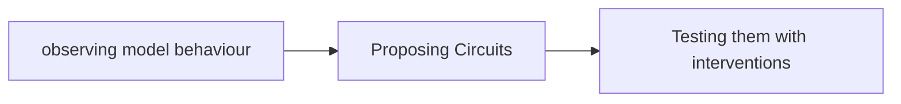

# Lec 25 : Mechanistic Intepretability

## How do we reverese-engineer the computation inside a neural network ?

> What internal computation produce the behaviour ?

Key terms :

- **Activations**
- **Attention Head**
- **Feature**
- **Circuits**

> [!NOTE]
> Attention Head $\not =$ Attention Weight.

---

## The behaviour to explain : Induction

Induction behaviour : match an earlier context and copy / retrive the continuation.

>Learn about **Induction head**.

The above is simplified induction circuit.

**QK**: Query  and **OV**:Output value.

> Look into slide for steps in circuit discovery

Circuit Validation is also explained in the slides.

- Test 1 : Abalations
- Test 2 : Activation Patching
- Test 3 : Path patching

>[!QUESTION]
> What makes a circuit explaination convincing

----

