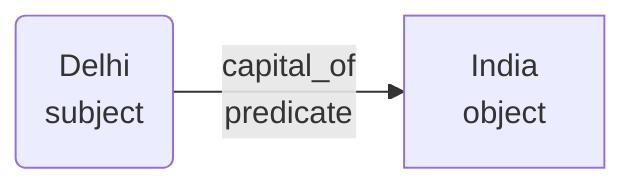

# Lec 26 : Introduction to RDF

## Introduction

**RDF** aka Resource Description Framework (RDF) is a data model that is used to describe resources
- Physical things
- Abstract concepts
- Number and Strings

It is a universal , machine data format.
It is represented in the form of tuples.
Example: \<Delhi\> \<capital_of\> \<India\>

These can be shown as graph btw subject and object.

>[!QUESTION] So what is the **URL** think we observe in these graphs?
> **SOLUTION**
> We need all the nodes to be uniquily identified, so we use the domains, like the url to make them unique.
---

## Identifiers

**URL** : Uniform Resource Location
- Eg : https:// used in web

**URN** : Uniform Resource Name
- Eg: ISBN used in books

**URI** : Unifrom Resource Identifier
- Ascii encoding

**IRI** : Internation Resource Identifier
- UTF-8 encoding

>[!NOTE]
> - In RDF we use IRI.
> - Literals and blank nodes do not have IRIs.

---

## Namespace

It is the logical grouping of unique identifiers
- xml namespace: xmlns=`"some link"`
- rdf namespace: rdf=`"some link"`
- rdfs namespace: rdfs=`"some link"`
- xsd namespace: xsd=`"some link"`

## Literals

Objects in a triple can be literals
Literals are constants. They can be values of strings, numbers and dates.

Eg: "1"^^xsd:interger

> [!TODO] How does the above relate with first order logic ?

---

## Serialisation Formats

There are different serilation format for writing RDF format.
- Json-LD
- XML
- N-Triples

### N-Triples

- Write each triples in one line ending with a dot.

1. \<s1\>\<p1\>\<o1\>.
2. \<s2\>\<p2\>\<o2\>.
3. \<s1\>\<p3\>\<s2\>.

> Look example in slide.

### Turtle

- Turtle is turse RDF Triple Language
- You prevent the repetition , of writing the same iri.
- You can have list , semi colon is used as seperation.
- Object list has comma seperations.

>[!NOTE] No of triples in the no of outgoing edges.

> Look example in slide.

---

## RDFS

**RDFS** is a semantic extension of RDF.
It provides the vocabulary for the RDF data.
It provides a mechanism to describe groups of related resouces.
Here **"S"** stands for schema.

### Classes

- Related resources can be categoriesed as class
- A class is defined using `rdfs:Class`
- Members of the class are called instances
- Classes can be subclass of another class. This is defined using `rdfs:subClassOf`

> SubClassOf is an implication

### Properties

- It is a relation between subject resource and objects
- similar to class we also have SubProperties
- Use `rdfs:Property` and `rdfs:subPropertyOf`
- A property can have a domain and range, which can defined by the using `rdfs:domain` and `rdfs:range`
- property is the intersection of all the defined domains

> Examples in slides.

>[!TIP] Overview
**RDFS** is Terminological Knowledge
**RDF** is Assertional Knowledge

---

## Property Graph

In modeling data property graph is easier.
But RDF is standardise which is also known as Knowledge Graphs.

---