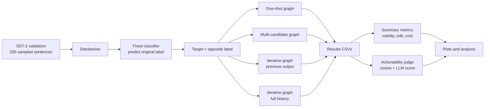
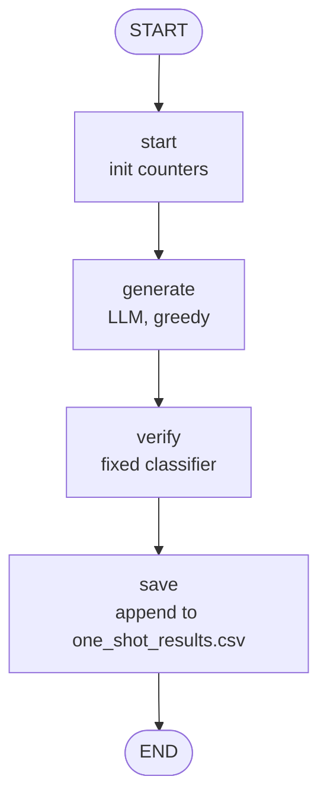
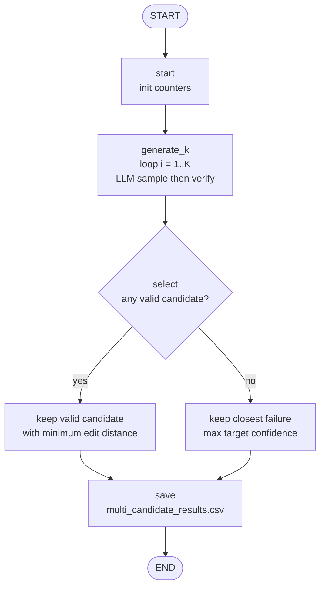
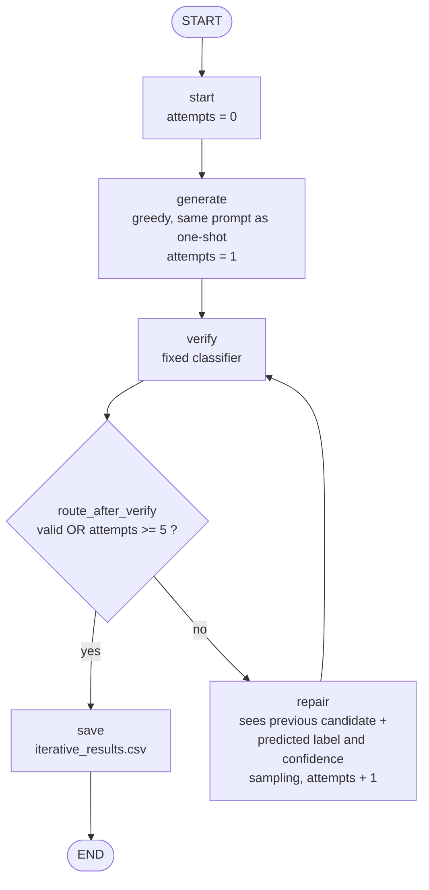
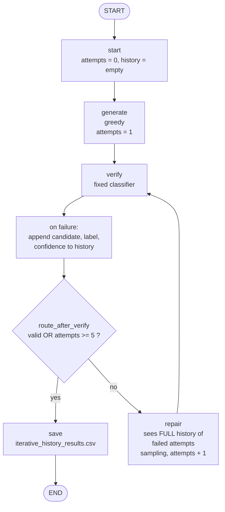
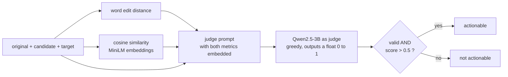
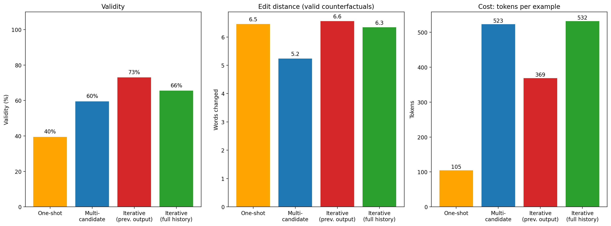
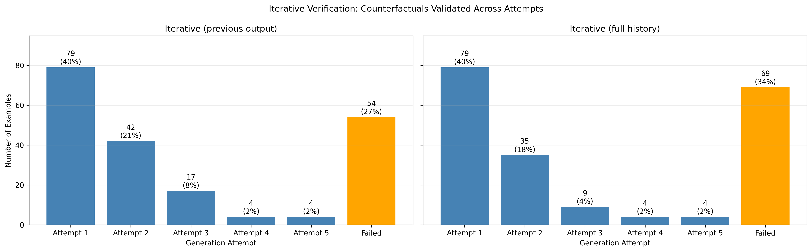
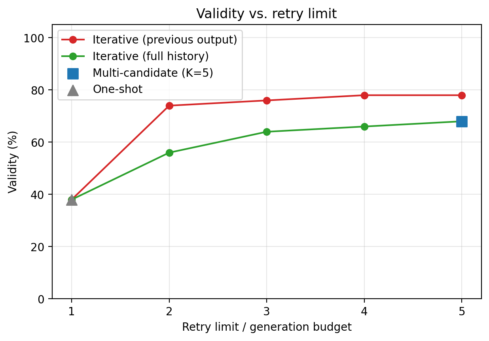
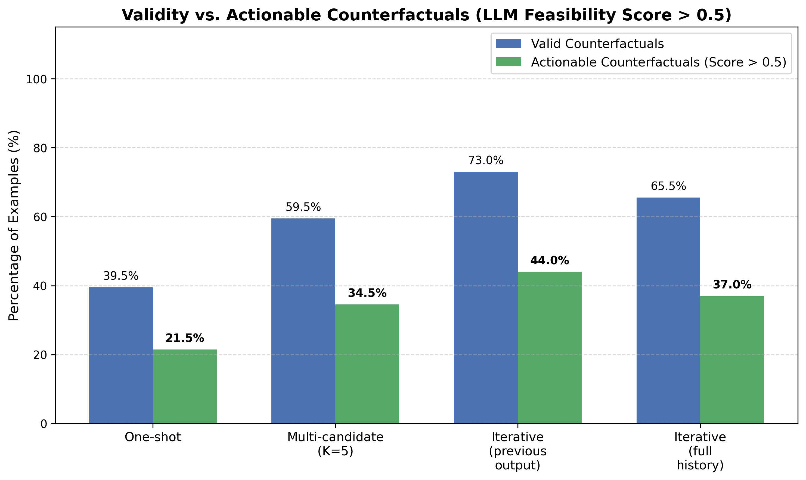

# Iterative Verification and Feedback-Driven Repair of LLM-Generated Counterfactual Explanations

**DS5622 Explainable AI, Course Project (Track 2: Extension of a Research Paper)**
M Sreenath Karthick (112301042) and M Murali Karthick (112301019)

> [!abstract] Abstract
> Large language models (LLMs) can write fluent counterfactual explanations, but Dehghanighobadi et al. (EMNLP 2025) show that these counterfactuals frequently fail to change the prediction of the model they are meant to explain. We extend this work by closing the loop. Each generated counterfactual is checked against a fixed classifier, and when it fails, the classifier's verdict is returned to the LLM so that it can revise its own output. Using SST-2, a fixed DistilBERT classifier and Qwen2.5-3B-Instruct as the generator, we compare one-shot generation, multi-candidate selection (K = 5) and two variants of iterative repair on 200 validation sentences. Iterative repair that sees only the previous output raises validity from 39.5% to 73.0% at roughly half the token cost of multi-candidate selection. Showing the model its entire failure history did **not** help (65.5%). Valid counterfactuals are not necessarily good ones, however. Under an LLM-judged feasibility score, only 44.0% of examples under the best method are both valid and actionable. We discuss why the history result should be read cautiously, and we flag several threats to validity, most importantly the use of a small judge model and a single random seed.

---

## 1. Introduction

A counterfactual explanation answers the question *"what would I have to change in this input for the model to decide differently?"* For text classification this means rewriting a sentence minimally so that the classifier's label flips, for example turning a negative movie review into one that a sentiment model reads as positive [Wachter et al., 2017; Mothilal et al., 2020]. LLMs are attractive generators of such explanations because they are fluent and can follow instructions such as "change as little as possible".

The difficulty is that the LLM does not have access to the classifier's decision boundary. It writes what *looks* like a counterfactual, and nothing guarantees that the classifier agrees. Dehghanighobadi et al. (2025) examine whether LLMs can explain themselves counterfactually and find a gap between plausible-sounding counterfactuals and actual changes in model behaviour. This gap is the starting point of our project.

Our extension is deliberately simple. If the problem is that generated counterfactuals are never checked, then we can check them. The classifier is cheap to query, so the verification result can be used as feedback in a repair loop. This report asks whether that loop is worth its cost.

### 1.1 Research questions

| ID | Question |
|----|----------|
| Q1 | Does iterative repair improve validity over one-shot generation and over multi-candidate selection? |
| Q2 | Does feedback accumulated from earlier failures (a memory of all failed attempts for the input) improve validity beyond feeding back only the most recent failure? |
| Q3 | What trade-offs arise between validity, amount of modification, and computational cost? |

> [!note] Terminology: feedback and feedback memory
> Throughout this report, *feedback* means the classifier's verdict (predicted label and confidence) on a failed candidate. We study two forms of it. In **iterative repair (previous output)** the LLM is shown only the most recent failure. In **iterative repair (full history)** the LLM is shown a *feedback memory*: every failed attempt for the current input, with the classifier's verdict on each. The memory is therefore accumulated and reused within the repair of one input. Transferring such feedback across inputs, for example by distilling it into guidelines learned from a separate development set, is a natural next step and is listed under [[#8. Future Work]].

---

## 2. Setup

| Component | Choice |
|-----------|--------|
| Dataset | SST-2 (GLUE), 200 sentences sampled from the validation split, seed 42 |
| Fixed classifier (the model being explained) | `distilbert-base-uncased-finetuned-sst-2-english`, never modified |
| Generator LLM | `Qwen2.5-3B-Instruct`, 4-bit NF4 quantisation (fits a free Colab T4) |
| Orchestration | LangGraph `StateGraph`, one graph per method |
| Target label | Always the opposite of the classifier's prediction on the original sentence (112 target NEGATIVE, 88 target POSITIVE) |
| Retry limit / candidate budget | `MAX_ATTEMPTS = K = 5` |
| Decoding | Greedy for the first attempt, sampling (T = 0.9, top-p = 0.9) for repairs and for multi-candidate |
| Semantic similarity | Cosine similarity of `all-MiniLM-L6-v2` embeddings |

Three implementation details matter for fairness.

1. **Shared first attempt.** All methods use the same initial prompt, and the first attempt of both iterative variants is the same greedy generation used by one-shot. As a sanity check, first-attempt validity of the iterative graphs is exactly 39.5%, identical to one-shot. Any gain therefore comes from the repair steps alone.
2. **Matched maximum budget.** Multi-candidate selection draws K = 5 samples, and iterative repair is allowed at most 5 attempts. The maximum number of LLM calls is therefore equal. The *expected* number differs because iterative repair stops at the first success.
3. **Pre-processing.** SST-2 is stored pre-tokenised (`it 's`, `do n't`). We detokenise before prompting so that the LLM sees natural text and so that edit distance is not inflated by whitespace.

### 2.1 Metrics

- **Validity.** Fraction of examples for which the classifier predicts the target label on the final candidate.
- **Edit distance.** Word-level Levenshtein distance between original and counterfactual (case and punctuation ignored), averaged over *valid* counterfactuals only. The relative form divides by original length.
- **Cost.** LLM calls, prompt plus generated tokens, and wall-clock seconds per example.
- **Cosine similarity.** A semantic-preservation proxy.
- **Actionability.** A counterfactual is called *actionable* if it is valid and an LLM judge assigns it a feasibility score above 0.5. The judge is shown the original, the rewrite, the target, the edit distance and the cosine similarity.

---

## 3. Methods

All four pipelines share a single `State` object (candidate, predicted label, confidence, validity, edit distance and cost counters), and each is a small LangGraph program. The diagrams below are drawn from the graph definitions in the notebook.

### 3.1 Overview of the evaluation pipeline



### 3.2 Baseline 1: one-shot generation

The LLM writes one counterfactual with greedy decoding. The classifier checks it, and the result is stored regardless of the outcome. This is the setting studied in the original paper.



### 3.3 Baseline 2: multi-candidate selection (K = 5)

Five independent candidates are sampled and each is verified. Among the valid ones we keep the candidate with the smallest edit distance. If none is valid, we retain the candidate with the highest target-class probability so that failures can be inspected. This baseline is *non-adaptive*, since the candidates never see each other or the classifier's verdicts.



### 3.4 Proposed method: iterative verification and repair (previous output only)

The first candidate is verified. If it fails and fewer than five attempts have been made, a repair prompt shows the LLM (i) the original sentence, (ii) its previous rewrite, and (iii) the label and confidence that the classifier produced for it. The LLM then writes a revision, which is verified in turn. The loop terminates on success or when the retry limit is reached. In LangGraph this is a conditional edge from `verify` to either `repair` or `save`.



### 3.5 Iterative repair with full failure history

This variant differs from the previous one in a single respect: the state carries a `history` list holding every failed candidate together with the classifier's verdict, and the repair prompt shows the entire list and instructs the model not to repeat earlier attempts.



### 3.6 Actionability evaluation

Validity says only that the classifier flipped. It does not say whether the rewrite is a sensible, minimal edit. We therefore add a second-stage judge on top of every method's final output.



---

## 4. Results

All numbers come from the same 200 sentences. Where we quote confidence intervals they are 95% Wilson intervals on a proportion with n = 200.

### 4.1 Main comparison

| Method | Validity (%) | 95% CI | Edit dist. (valid) | Relative edit | LLM calls | Tokens | Seconds |
|---|---|---|---|---|---|---|---|
| One-shot | 39.5 | [33.0, 46.4] | 6.46 | 0.41 | 1.00 | 104.6 | 2.18 |
| Multi-candidate (K = 5) | 59.5 | [52.6, 66.1] | **5.24** | **0.33** | 5.00 | 523.3 | 10.87 |
| Iterative (previous output) | **73.0** | [66.5, 78.7] | 6.56 | 0.42 | 2.60 | 368.9 | 5.67 |
| Iterative (full history) | 65.5 | [58.7, 71.7] | 6.34 | 0.39 | 2.78 | 532.1 | 6.01 |



*Figure 1. Left: validity. Middle: mean word edit distance over valid counterfactuals. Right: tokens per example.*

**Q1.** Iterative repair with previous-output feedback is the most valid method, 33.5 points above one-shot and 13.5 points above multi-candidate selection. The interval for iterative repair (66.5 to 78.7) does not overlap that of one-shot, and it only just clears the upper end of the multi-candidate interval (66.1). The one-shot comparison is therefore clear, whereas the comparison with multi-candidate is suggestive but should be confirmed with more examples or a paired test.

### 4.2 Cost-adjusted view (Q3)

Because iterative methods stop early, raw cost per example flatters them, whereas validity flatters the expensive methods. Dividing cost by validity gives the expected cost of obtaining *one* valid counterfactual, assuming failures are retried at the same rate.

| Method | LLM calls per valid CF | Tokens per valid CF | Seconds per valid CF |
|---|---|---|---|
| One-shot | 2.5 | 265 | 5.5 |
| Multi-candidate | 8.4 | 879 | 18.3 |
| Iterative (previous output) | **3.6** | **505** | **7.8** |
| Iterative (full history) | 4.2 | 812 | 9.2 |

One-shot is still the cheapest per valid output, but it only succeeds 40% of the time, so a practitioner who needs a counterfactual for *every* input must pay for something more. Within the methods that deliver high coverage, iterative repair dominates: it uses roughly 43% fewer tokens than multi-candidate selection and reaches higher validity. The one dimension on which multi-candidate wins is edit distance. Its selection rule explicitly minimises edits (5.2 words versus 6.6), whereas the iterative methods stop at the first valid output, which need not be the smallest.

### 4.3 Where do the successes come from?



*Figure 2. Number of examples that first become valid at each attempt, and the number never valid within five attempts.*

| | Attempt 1 | 2 | 3 | 4 | 5 | Failed |
|---|---|---|---|---|---|---|
| Previous output | 79 | 42 | 17 | 4 | 4 | 54 |
| Full history | 79 | 35 | 9 | 4 | 4 | 69 |

Of the 121 examples that failed on the first attempt, previous-output repair rescued 67 (55%) and history repair rescued 52 (43%). The distribution is sharply front-loaded: the second attempt alone recovers 42 examples, whereas the fourth and fifth together recover only 8.



*Figure 3. Validity as a function of the retry limit (sensitivity analysis).*

Validity at retry limits 1 to 5 is 39.5, 60.5, 69.0, 71.0 and 73.0% (previous output) and 39.5, 57.0, 61.5, 63.5 and 65.5% (history). The curve has a clear knee at k = 2 to 3. A limit of 3 already captures 94% of the final gain for previous-output repair, so the nominal budget of 5 is generous. Reducing it to 3 would save compute at little cost in validity.

### 4.4 Does full history help? (Q2)

No. The full-history variant is worse at every retry limit from 2 onwards and leaves 15 more examples unresolved. It also costs about 44% more tokens (532 vs 369) because the prompt grows with each failure. Two observations suggest that the result needs a careful reading.

- At attempt 2 the two prompts contain *exactly the same information*: one failed candidate and its verdict. Yet they recover 42 and 35 examples respectively. This gap cannot be caused by "having more history", and must be attributed to differences in prompt wording and sampling noise. It gives us an informal estimate of how large such nuisance variation is, and it is comparable in size to the overall gap between the methods (7.5 points, or 15 examples, at attempt 5).
- With one seed and n = 200, the intervals for the two iterative variants overlap substantially ([66.5, 78.7] and [58.7, 71.7]).

The defensible conclusion is therefore that **we find no evidence that the full history helps**, and weak evidence that it may hurt. A plausible mechanism is that a 3B-parameter model handles a long list of its own failures poorly. It may anchor on earlier phrasings, or over-correct by drifting away from the source sentence (the example shown in the notebook, where the history variant ends with a sentence that retains the original negative clause and adds a contrastive tail, is consistent with this). We did not test this mechanism directly.

### 4.5 Actionability



*Figure 4. Percentage of examples that are valid, and percentage that are both valid and judged actionable (score > 0.5).*

| Method | Valid (%) | Actionable (%) | Actionable given valid (%) |
|---|---|---|---|
| One-shot | 39.5 | 21.5 | 54 |
| Multi-candidate | 59.5 | 34.5 | 58 |
| Iterative (previous output) | 73.0 | **44.0** | 60 |
| Iterative (full history) | 65.5 | 37.0 | 57 |

The ranking of methods is unchanged, but the headline numbers drop considerably: even under the best method, 56% of examples either fail or yield an unnatural or unfaithful rewrite. Conditional on being valid, the actionable fraction is similar across methods (54 to 60%), so the iterative methods' advantage comes mostly from producing *more* valid counterfactuals, not from producing *better* ones. Over all 475 valid counterfactuals, the mean cosine similarity to the original is 0.856, and the mean judge score is 0.514 with a standard deviation of 0.388. The 25th percentile of the judge score is exactly 0, which indicates a bimodal distribution (see the caveat below).

---

## 5. Discussion

**Verification is the main ingredient.** The single biggest improvement in the study comes from the simple act of consulting the classifier and retrying. This supports the premise of the original paper: LLM counterfactuals are frequently wrong, but they are *checkable*, and the check is cheap relative to the generation.

**Adaptive beats parallel at equal maximum budget.** Multi-candidate selection spends all five calls on every input, including the 48 sentences for which all five samples were valid and the 81 for which none were. Iterative repair spends calls only where they are needed and conditions each new attempt on the failure it is repairing. That the latter is both cheaper and more valid is consistent with the view that feedback carries information that independent resampling does not. We caution that our two approaches also differ in decoding (greedy first attempt versus all-sampled candidates), so some of the difference could be due to that choice.

**Validity is not the end of the story.** The iterative methods produce slightly larger edits than multi-candidate selection (6.6 vs 5.2 words), and a feasibility judge accepts only about 60% of the valid counterfactuals. A classifier flip that is achieved by rewriting half the sentence is valid but is hardly an *explanation* of the original prediction. This points to a missing component in our loop: the verification step checks only the label, so nothing pushes the model toward minimal or faithful edits after validity has been reached.

**A failure pattern.** Inspection of the failed examples shows that many are sentences with mixed sentiment (for instance "a great ensemble cast can't lift this heartfelt…") or with strong lexical cues the model is reluctant to remove. In these cases the classifier is evidently driven by a few salient tokens, and the LLM often makes a semantically plausible change that leaves those tokens in place. This is an instance of the plausibility-versus-faithfulness gap that motivated the project.

---

## 6. Reproducibility

The experiment is contained in a single notebook, `XAI_project_langgragh.ipynb`, and was run on a free Colab T4 GPU.

```text
Project/
├── Docs/
│   ├── xai_project_proposal.pdf
│   └── XAI_Project_Report.md
├── Results/
│   ├── one_shot_results.csv
│   ├── multi_candidate_results.csv
│   ├── iterative_results.csv
│   ├── iterative_history_results.csv
│   ├── summary_all_methods.csv
│   ├── all_methods_actionability.csv
│   └── *.png                      (figures used in this report)
├── XAI_project_langgragh.ipynb
└── README.md
```

- **Dependencies:** `transformers`, `accelerate`, `bitsandbytes`, `datasets`, `langgraph`, `sentence-transformers`, `torch`, `pandas`, `matplotlib`.
- **Configuration:** all settings (`SEED = 42`, `N_EVAL = 200`, `K = 5`, `MAX_ATTEMPTS = 5`, `MAX_NEW_TOKENS = 100`, `ACTIONABILITY_THRESHOLD = 0.5`) are defined in one cell at the top of the notebook.
- **Determinism:** the seed is reset before each method is run. Greedy decoding is deterministic given the quantised weights, but sampled steps may still vary across hardware and library versions.

---

## 7. Limitations and Threats to Validity

1. **Single seed, single run, n = 200.** No variance across random seeds is reported. The gap between the two iterative variants in particular is within plausible run-to-run noise (see [[#4.4 Does full history help? (Q2)]]). A paired test such as McNemar's on the per-example outcomes, and repeated runs, would be the proper way to settle it.
2. **Feedback memory is scoped to a single input.** The history is accumulated and used only while repairing one sentence. The result for history should not be extrapolated to feedback learned from other inputs and applied to unseen ones, which we did not study.
3. **The judge is the generator's own model family and size.** Using Qwen2.5-3B to grade Qwen2.5-3B outputs risks self-preference, and small models are known to be unreliable judges [Zheng et al., 2023]. The strongly bimodal score distribution (25th percentile at exactly 0.0, median 0.75) suggests that some zeros may be parsing failures or degenerate outputs rather than genuine low-feasibility judgements, because the regex defaults to 0.0 when no number is found. The *absolute* actionability numbers should therefore be treated as a rough proxy, and we place more weight on the relative ordering. We did not validate the judge against human annotation.
4. **Confounded design in the multi-candidate comparison.** Multi-candidate uses sampling for all five candidates, whereas the iterative methods use a greedy first attempt. Equalising the first-step decoding would isolate the effect of feedback more cleanly.
5. **Edit-distance asymmetry.** Multi-candidate explicitly minimises edit distance among valid candidates, while the iterative methods do not, so the comparison on that metric is not like-for-like. Edit distance is also averaged only over valid counterfactuals, and the valid subsets differ between methods (selection effect).
6. **One classifier, one dataset, one small generator.** SST-2 is a binary task with strong lexical cues, and DistilBERT is a small classifier. The conclusions may not transfer to multi-class tasks, larger generators (which may fail less often, or use history better), or classifiers with less lexical behaviour.
7. **Labels are checked, not mechanisms.** A valid counterfactual shows that the classifier output changed, but it does not show that the edit corresponds to what the classifier actually relies on. Validity is a necessary condition for a useful explanation, and certainly not a sufficient one.
8. **Unused configuration.** The notebook defines `ROBUST_CONF = 0.9` (a confidence threshold for "robust" flips) but no robustness analysis was performed. Flips that barely cross the decision boundary are counted as valid.

---

## 8. Future Work

- Extend the feedback memory beyond a single input (**cross-example memory**): collect failures on a development split, distil them into reusable guidelines, or use them as external training data for the generator, and measure the effect on a disjoint held-out split. The prompt templates already contain an optional `guidelines` slot for this purpose.
- Add a **post-validity minimisation step** (for example, greedily reverting edits while the label stays flipped) so that iterative methods can compete with multi-candidate selection on edit distance.
- Use a **stronger or independent judge** and human annotation on a subset to calibrate the actionability score.
- Repeat with multiple seeds, report paired significance tests, and apply a **robustness threshold** using the already-defined `ROBUST_CONF`.
- Test other tasks and generator sizes to see whether the history result is a small-model effect.

---

## 9. Conclusion

Verifying LLM-generated counterfactuals against the model being explained, and feeding the failure back into the generator, nearly doubles validity on SST-2 (39.5% to 73.0%) at about 3.6 LLM calls per valid counterfactual, which is substantially cheaper than drawing five independent candidates. Most of the gain arrives within two to three attempts. Giving the generator a memory of its entire failure history did not help in our setup, although with one seed the difference from simple repair is not conclusive. Finally, validity overstates quality: only 44% of examples are valid and judged actionable even under the best method, which shows that a label-only verifier is not enough, and that future loops should also verify minimality and faithfulness.

---

## 10. LLM-Use Disclosure

> [!note] Please review and edit this section so that it matches exactly what the team did.

- **Code:** LLM assistance was used for drafting and debugging parts of the notebook (LangGraph wiring, plotting code). All pipelines were executed by the team, and correctness was checked through sanity tests (for example, first-attempt validity of the iterative graphs must equal one-shot validity, and it does: 39.5% in both).
- **Experiments:** The generator and the judge are themselves LLMs (Qwen2.5-3B-Instruct), as described above. The classifier is a standard pre-trained DistilBERT model.
- **Report:** An LLM was used to help draft and structure this report. All figures were taken from the notebook outputs, and derived quantities (cost per valid counterfactual, conditional actionability rates, confidence intervals) were recomputed from the reported numbers.
- **Verification:** Both team members are expected to be able to explain the method, the code and the results in the viva.

---

## References

1. Dehghanighobadi, Z., Fischer, A., Zafar, M. B. (2025). *Can LLMs Explain Themselves Counterfactually?* Proceedings of EMNLP 2025, 7787-7815.
2. Wachter, S., Mittelstadt, B., Russell, C. (2017). *Counterfactual Explanations without Opening the Black Box.* Harvard Journal of Law & Technology.
3. Mothilal, R. K., Sharma, A., Tan, C. (2020). *Explaining Machine Learning Classifiers through Diverse Counterfactual Explanations.* FAT\* 2020.
4. Ustun, B., Spangher, A., Liu, Y. (2019). *Actionable Recourse in Linear Classification.* FAT\* 2019.
5. Karimi, A.-H., Barthe, G., Schölkopf, B., Valera, I. (2022). *A Survey of Algorithmic Recourse: Contrastive Explanations and Consequential Recommendations.* ACM Computing Surveys.
6. Zheng, L. et al. (2023). *Judging LLM-as-a-Judge with MT-Bench and Chatbot Arena.* NeurIPS 2023.
7. Qwen2.5-3B-Instruct: https://huggingface.co/Qwen/Qwen2.5-3B-Instruct
8. DistilBERT SST-2: https://huggingface.co/distilbert/distilbert-base-uncased-finetuned-sst-2-english
9. GLUE / SST-2: https://huggingface.co/datasets/nyu-mll/glue
10. Sentence-Transformers `all-MiniLM-L6-v2`: https://huggingface.co/sentence-transformers/all-MiniLM-L6-v2
11. LangGraph: https://langchain-ai.github.io/langgraph/