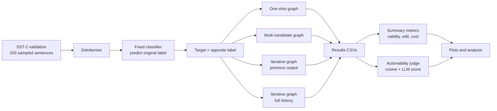
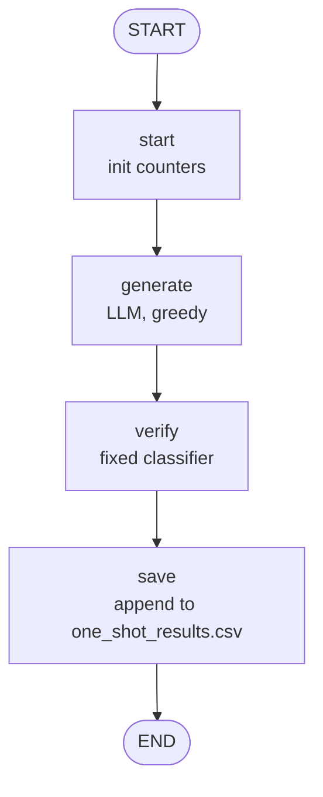
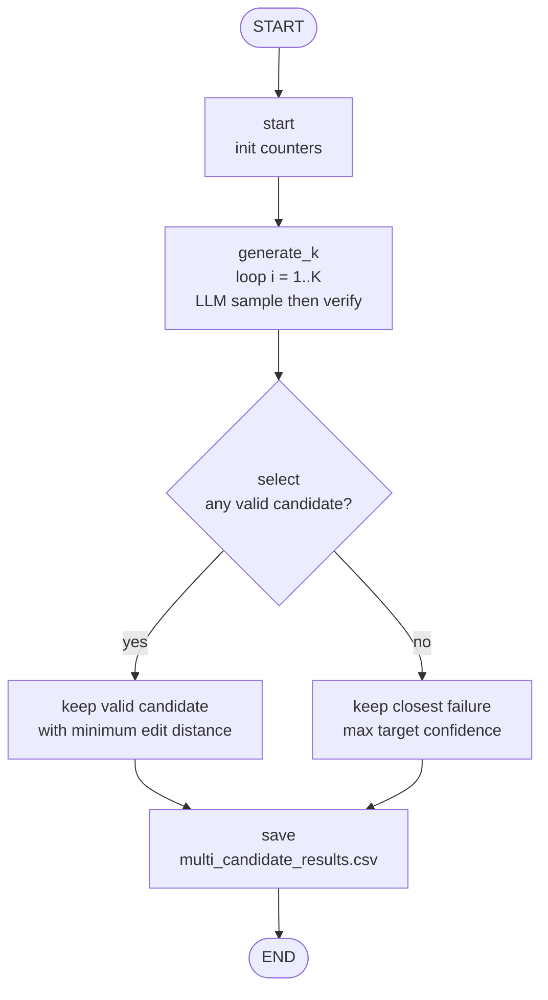
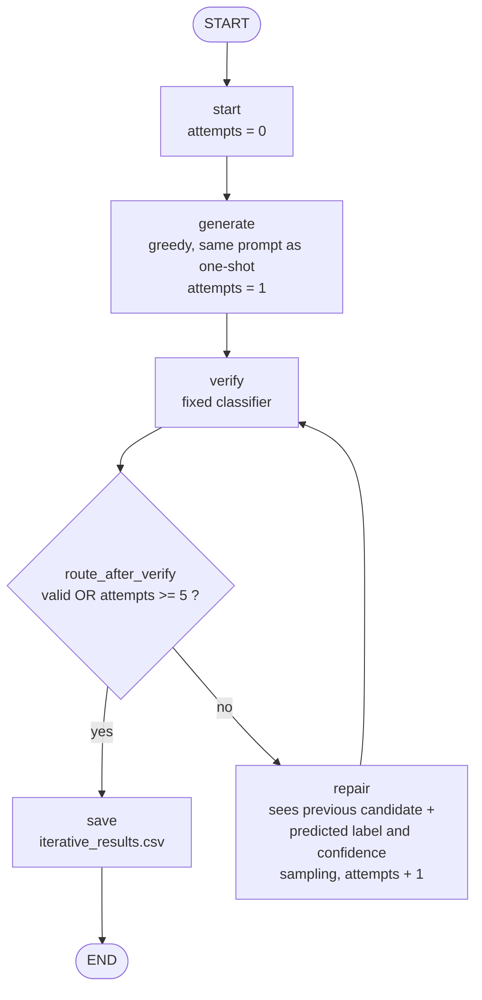
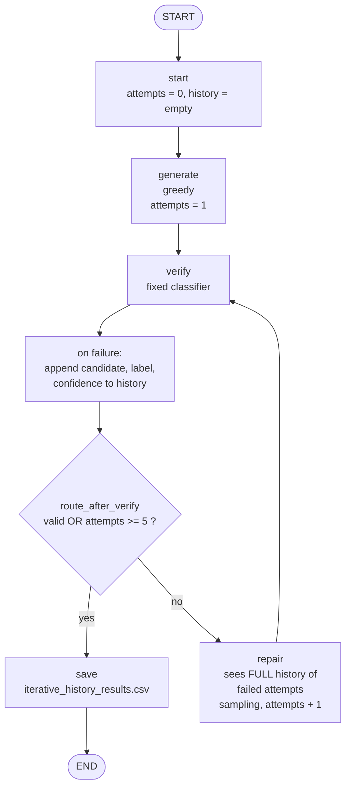
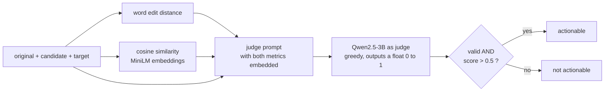
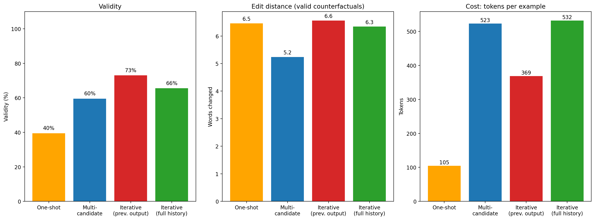
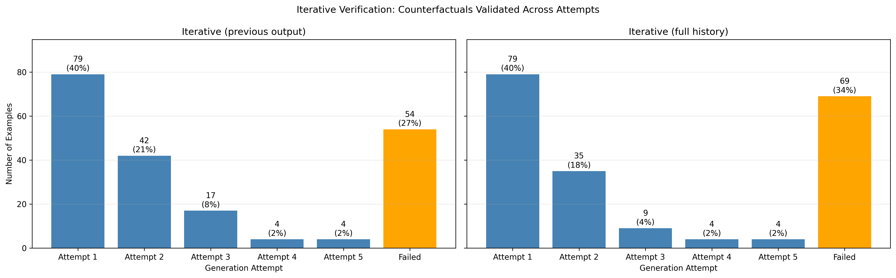
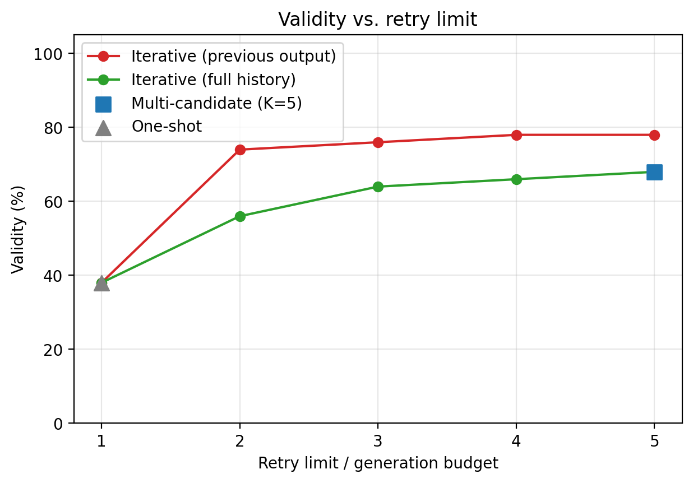
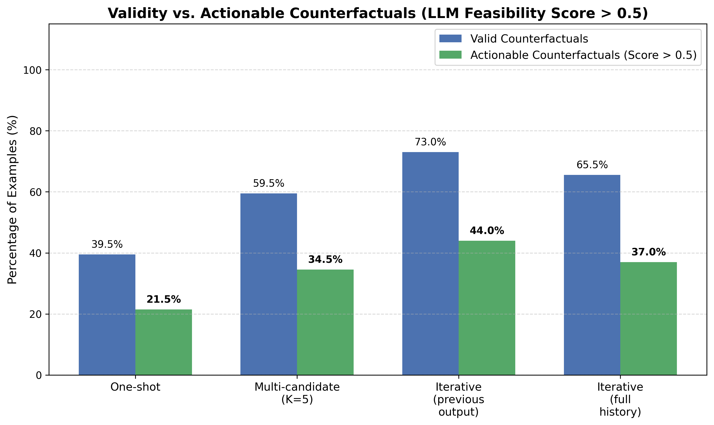

# Iterative Verification and Feedback-Driven Repair of LLM-Generated Counterfactual Explanations

**DS5622 Explainable AI, Course Project
( Track 2: Extension of a Research Paper )**

GitHub: https://github.com/SreenathKarthick11/DS5622-Explainable-AI

---

## 1. Introduction

A counterfactual explanation answers the question *"what would I have to change in this input for the model to decide differently?"*. For text classification this means rewriting a sentence minimally so that the classifier's label flips, for example turning a negative movie review into one that a sentiment model reads as positive [Wachter et al., 2017; Mothilal et al., 2020]. LLMs are attractive generators of such explanations because they are fluent and can follow instructions such as "change as little as possible".

The difficulty is that the LLM does not have access to the classifier's decision boundary. It writes what *looks* like a counterfactual and nothing guarantees that the classifier agrees. Dehghanighobadi et al. (2025) examine whether LLMs can explain themselves counterfactually and find a gap between plausible-sounding counterfactuals and actual changes in model behaviour. This gap is the starting point of our project.

Our extension is deliberately simple. If the problem is that generated counterfactuals are never checked, then we can check them. The classifier is cheap to query, so the verification result can be used as feedback in a repair loop. This report asks whether that loop is worth its cost.

### 1.1 Research questions

| ID | Question |
|----|----------|
| Q1 | Does iterative repair improve validity over one-shot generation and over multi-candidate selection? |
| Q2 | What trade-offs arise between validity, amount of modification and computational cost? |
| Q3 | Does feedback accumulated from earlier failures (a memory of all failed attempts for the input) improve validity beyond feeding back only the most recent failure? |

> [!Caution] Terminology: feedback and feedback memory
> *Feedback* refers to the classifier's predicted label and confidence for a failed candidate. In **iterative repair (previous output)**, the LLM receives only the latest failure, while **iterative repair (full history)** provides a *feedback memory* containing all previous failures and their classifier verdicts for the current input. Transferring this feedback across inputs through learned guidelines is left for [[#7. Future Work]].

---

## 2. Setup

| Component | Choice |
|-----------|--------|
| Dataset | SST-2 (GLUE), 200 sentences sampled from the validation split, seed 42 |
| Fixed classifier (the model being explained) | `distilbert-base-uncased-finetuned-sst-2-english` |
| Generator LLM | `Qwen2.5-3B-Instruct`, 4-bit NF4 quantisation (fits in a free Colab T4) |
| Orchestration | `LangGraph` |
| Target label | Always the opposite of the classifier's prediction on the original sentence |
| Semantic similarity | Cosine similarity of `all-MiniLM-L6-v2` embeddings |

Two implementation details matter for fairness.

1. **Shared first attempt.** All methods use the same initial prompt and the first attempt of both iterative variants is the same greedy generation used by one-shot. As a sanity check, first-attempt validity of the iterative graphs is exactly 39.5%, identical to one-shot. Any gain therefore comes from the repair steps alone.
2. **Pre-processing.** SST-2 is stored pre-tokenised (`it 's`, `do n't`). We detokenise before prompting so that the LLM sees natural text and so that edit distance is not inflated by whitespace.

### 2.1 Metrics

- **Validity.** Fraction of examples for which the classifier predicts the target label on the final candidate.
- **Edit distance.** Word-level Levenshtein distance between original and counterfactual (case and punctuation ignored), averaged over *valid* counterfactuals only. The relative form divides by original length.
- **Cost.** LLM calls, prompt plus generated tokens and wall-clock seconds per example.
- **Cosine similarity.** A semantic-preservation proxy.
- **Actionability.** A counterfactual is called *actionable* if it is valid and an LLM judge assigns it a feasibility score above 0.5. The judge is shown the original, the rewrite, the target, the edit distance and the cosine similarity.

---

## 3. Methods

All four pipelines share a single `State` object (candidate, predicted label, confidence, validity, edit distance and cost counters) and each is a small LangGraph program. The diagrams below are drawn from the graph definitions in the notebook.

### 3.1 Overview of the evaluation pipeline

### 3.2 Baseline 1: one-shot generation

The LLM writes one counterfactual with greedy decoding. The classifier checks it and the result is stored regardless of the outcome. This is the setting studied in the original paper.

### 3.3 Baseline 2: multi-candidate selection (K = 5)

Five independent candidates are sampled and each is verified. Among the valid ones we keep the candidate with the smallest edit distance. If none is valid, we retain the candidate with the highest target-class probability so that failures can be inspected. This baseline is *non-adaptive*, since the candidates never see each other or the classifier's verdicts.

### 3.4 Proposed method 1: iterative verification and repair (previous output only)

The first candidate is verified. If it fails and fewer than five attempts have been made, a repair prompt shows the LLM (i) the original sentence, (ii) its previous rewrite and (iii) the label and confidence that the classifier produced for it. The LLM then writes a revision, which is verified in turn. The loop terminates on success or when the retry limit is reached. In LangGraph this is a conditional edge from `verify` to either `repair` or `save`.

### 3.5 Iterative repair with full failure history

This variant differs from the previous one in a single respect: the state carries a `history` list holding every failed candidate together with the classifier's verdict and the repair prompt shows the entire list and instructs the model not to repeat earlier attempts.

### 3.6 Actionability evaluation

Validity says only that the classifier flipped. It does not say whether the rewrite is a sensible, minimal edit. We therefore add a second-stage judge on top of every method's final output.

---

## 4. Results

All numbers come from the same 200 sentences. Where we quote confidence intervals they are 95% Wilson intervals on a proportion with n = 200.

### 4.1 Main comparison

| Method | Validity (%) | 95% CI | Edit dist. (valid) | Rel. edit | LLM calls | Tokens | Seconds |
|---|---|---|---|---|---|---|---|
| One-shot | 39.5 | [33.0, 46.4] | 6.46 | 0.41 | 1.00 | 104.6 | 2.18 |
| Multi-candidate (K = 5) | 59.5 | [52.6, 66.1] | 5.24 | 0.33 | 5.00 | 523.3 | 10.87 |
| Iterative (previous output) | **73.0** | [66.5, 78.7] | 6.56 | 0.42 | 2.60 | 368.9 | 5.67 |
| Iterative (full history) | 65.5 | [58.7, 71.7] | 6.34 | 0.39 | 2.78 | 532.1 | 6.01 |

*Figure 1. Left: validity. Middle: mean word edit distance over valid counterfactuals. Right: tokens per example.*

> [!Note] Answer to Q1
> Iterative repair with previous-output feedback achieves the highest validity (73.0%), improving by 33.5 percentage points over one-shot and 13.5 points over multi-candidate selection. Its confidence interval does not overlap with one-shot and narrowly exceeds multi-candidate's upper bound, suggesting a stronger improvement that warrants further statistical validation.

### 4.2 Cost-adjusted view

Dividing computational cost by validity estimates the cost of obtaining one valid counterfactual (CF), assuming failures are retried at the same rate.

| Method | LLM calls per valid CF | Tokens per valid CF | Seconds per valid CF |
|---|---|---|---|
| One-shot | 2.5 | 265 | 5.5 |
| Multi-candidate | 8.4 | 879 | 18.3 |
| Iterative (previous output) | **3.6** | **505** | **7.8** |
| Iterative (full history) | 4.2 | 812 | 9.2 |

One-shot is the cheapest per valid output but achieves only 39.5% validity. Among higher-coverage methods, previous-output iterative repair uses approximately 43% fewer tokens than multi-candidate selection while achieving higher validity. Multi-candidate selection produces smaller edits (5.24 vs. 6.56 words) because it explicitly selects the candidate with minimum edit distance.

> [!Note] Answer to Q2
> One-shot generation minimises cost but has low validity, while multi-candidate selection produces smaller edits at a substantially higher computational cost. Previous-output iterative repair offers the best overall balance, achieving the highest validity (73.0%) at a lower cost than multi-candidate selection.

### 4.3 Where do the successes come from?

*Figure 2. Number of examples that first become valid at each attempt and the number never valid within five attempts.*

Of the 121 examples that failed on the first attempt, previous-output repair rescued 67 (55%), while full-history repair rescued 52 (43%). Most improvements occur early, with the second attempt alone recovering 42 examples.

*Figure 3. Validity as a function of the retry limit (sensitivity analysis).*

Both methods show diminishing returns after the third attempt. A retry limit of 3 captures approximately 94% of the total validity gain for previous-output repair, suggesting that additional attempts provide limited benefit relative to their computational cost.

### 4.4 Does full history help?

Full-history feedback does not improve validity over previous-output feedback. It performs worse at every retry limit after the first and leaves 15 more examples unresolved at the fifth attempt. It also consumes approximately 44% more tokens (532 vs. 369 per example).

However, the confidence intervals overlap substantially (previous output: [66.5, 78.7]; full history: [58.7, 71.7]) and the experiment uses a single seed. At the second attempt, both methods receive exactly the same information, yet recover 42 and 35 examples respectively. This suggests that prompt wording and sampling variation may contribute to the observed difference.

> [!Note] Answer to Q3
> **No**. Full-history repair achieves 65.5% validity compared with 73.0% for previous-output repair, while consuming 44% more tokens. We find no evidence that retaining all previous failures improves validity; however, further experiments are needed to establish whether it consistently hurts performance.

### 4.5 Actionability

*Figure 4. Percentage of examples that are valid and percentage that are both valid and judged actionable (score > 0.5).*

The ranking of methods remains unchanged, but the proportion of examples producing useful counterfactuals is considerably lower. Even under the best-performing method, 56% of examples either fail to produce a valid counterfactual or yield a rewrite that is unnatural or insufficiently actionable. Among valid counterfactuals, the actionable fraction is relatively consistent across methods (54-60%), suggesting that the advantage of iterative repair comes primarily from generating *more* valid counterfactuals rather than improving the quality of each valid rewrite. Across all 475 valid counterfactuals, the mean cosine similarity to the original sentence is 0.856, while the mean judge score is 0.514 (standard deviation 0.388). The 25th percentile of the judge score is zero, indicating that a substantial proportion of valid counterfactuals receive very low feasibility scores despite the moderate overall mean.

---

## 5. Discussion

**Verification drives improvement.** The largest gain comes from using classifier feedback to verify counterfactuals and guide retries. This supports the premise that LLM-generated counterfactuals are often invalid but can be improved through inexpensive verification.

**Adaptive repair outperforms parallel sampling.** Iterative repair achieves higher validity at lower cost than multi-candidate selection by using feedback to guide subsequent attempts rather than generating independent candidates. However, differences in decoding strategies may also contribute to this result.

**Validity does not guarantee quality.** Iterative methods produce slightly larger edits than multi-candidate selection (6.6 vs. 5.2 words). Moreover, only about 60% of valid counterfactuals pass the feasibility judge. This highlights the need to optimise minimality and faithfulness alongside classifier validity.

**Challenges with mixed sentiment.** Many failures involve mixed-sentiment sentences or strong lexical cues that the classifier relies on. Although the LLM often generates semantically plausible changes, it may retain these influential cues, exposing the gap between plausibility and faithfulness.

---

## 6. Limitations and Threats to Validity

1. **Single seed, small sample (n = 200):** No variance across seeds is reported, so differences between iterative variants may be sampling noise. Repeated runs and paired tests (e.g., McNemar's) are needed.
2. **Input-specific feedback memory:** History is kept only per sentence, so results do not extend to feedback learned across inputs.
3. **Feasibility judge:** Qwen2.5-3B judges outputs from its own model family (self-preference risk), was not validated against human annotations and may suffer parsing failures. Absolute scores are approximate.
4. **Confounded multi-candidate comparison:** Multi-candidate uses sampling for all five attempts, while iterative repair starts with a greedy attempt; this decoding difference may affect results independently of feedback.
5. **Edit-distance comparison:** Multi-candidate explicitly minimises edit distance, whereas iterative repair stops at the first valid output. Edit distance is also averaged over valid examples only and these subsets differ across methods.
6. **Limited scope:** One dataset (SST-2), one classifier (DistilBERT) and one small generator (Qwen2.5-3B); results may not transfer.
7. **Validity is not faithfulness:** A label flip does not show that the edit reflects the features driving the original prediction. Validity is necessary but insufficient.

---

## 7. Future Work

- Extend the feedback memory beyond a single input (**cross-example memory**): collect failures on a development split, distil them into reusable guidelines, or use them as external training data for the generator and measure the effect on a disjoint held-out split. The prompt templates already contain an optional `guidelines` slot for this purpose.
- Add a **post-validity minimisation step** (for example, greedily reverting edits while the label stays flipped) so that iterative methods can compete with multi-candidate selection on edit distance.
- Use a **stronger or independent judge** and human annotation on a subset to calibrate the actionability score.
- Test other tasks and generator sizes to see whether the history result is a small-model effect.

---

## 8. Conclusion

Iterative repair with classifier feedback improves counterfactual validity on SST-2 from 39.5% to 73.0%, outperforming independent multi-candidate selection at lower computational cost. Most gains occur within two to three attempts, while full-history feedback provides no additional benefit. However, validity alone does not guarantee useful explanations, highlighting the need for future methods to verify minimality, feasibility and faithfulness alongside label changes.

---

## 9. LLM-Use Disclosure

Claude (Anthropic) and ChatGPT (OpenAI) were used as coding assistants for debugging the project code, such as fixing errors in the notebook and the LangGraph pipelines. Claude was additionally used to convert the authors' Markdown report (`report.md`, available in the project directory of the GitHub repository https://github.com/SreenathKarthick11/DS5622-Explainable-AI) into the accompanying LaTeX document. This included converting the authors' original Mermaid diagrams into TikZ figures. Neither tool was used to generate the report's content. The experimental design, analysis, results and writing, as well as the original Mermaid diagrams, are the authors' own work.

---

## References

1. Dehghanighobadi, Z., Fischer, A., Zafar, M. B. (2025). *Can LLMs Explain Themselves Counterfactually?* Proceedings of EMNLP 2025, 7787-7815.
2. Wachter, S., Mittelstadt, B., Russell, C. (2017). *Counterfactual Explanations without Opening the Black Box.* Harvard Journal of Law & Technology.
3. Mothilal, R. K., Sharma, A., Tan, C. (2020). *Explaining Machine Learning Classifiers through Diverse Counterfactual Explanations.* FAT\* 2020.
4. Qwen2.5-3B-Instruct: https://huggingface.co/Qwen/Qwen2.5-3B-Instruct
5. DistilBERT SST-2: https://huggingface.co/distilbert/distilbert-base-uncased-finetuned-sst-2-english
6. GLUE / SST-2: https://huggingface.co/datasets/nyu-mll/glue
7. Sentence-Transformers `all-MiniLM-L6-v2`: https://huggingface.co/sentence-transformers/all-MiniLM-L6-v2
8. LangGraph: https://langchain-ai.github.io/langgraph/
9. GitHub Project Link: https://github.com/SreenathKarthick11/DS5622-Explainable-AI/tree/main/Project